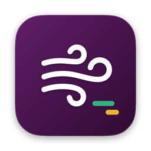
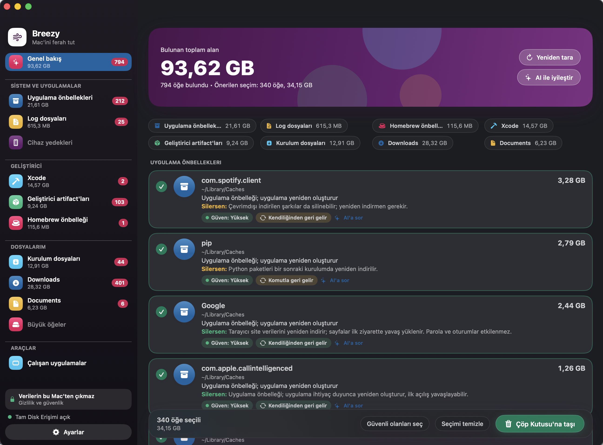

<div align="center">



# Breezy

**Mac'ini güvenle ferahlat.**

Gereksiz dosyaları bulur, silince ne olacağını açıklar ve yalnızca senin onayınla Çöp Kutusu'na taşır.<br/>
Verilerin bu Mac'ten çıkmaz.


[](LICENSE)

[Özellikler](#özellikler) · [Derleme](#derleme-ve-çalıştırma) · [Gizlilik](#gizlilik-ve-güvenlik) · [Mimari](#mimari) · [Tanıtım sayfası](docs/index.html)



</div>

> 🇬🇧 **English summary:** Breezy is a native, privacy-first macOS cleanup app (SwiftUI, macOS 26). It finds caches, logs, build artifacts, stale Downloads/Documents and large forgotten items; explains what happens if you delete each one; and only ever moves things to the Trash after you approve. It also warns you when your disk fills up and lists the apps using the most memory. It makes no network connections unless you enable the optional AI advisor, which only ever sees redacted paths and sizes. Build from source with `scripts/make-app.sh`.

---

## İçindekiler
1. [Neden Breezy?](#neden-breezy)
2. [Özellikler](#özellikler)
3. [Nasıl çalışır?](#nasıl-çalışır)
4. [Gizlilik ve güvenlik](#gizlilik-ve-güvenlik)
5. [Ne taranır? Kurallar](#ne-taranır-kurallar)
6. [Güven seviyesi ve "silersen ne olur" analizi](#güven-seviyesi-ve-silersen-ne-olur-analizi)
7. [AI danışmanı ve sağlayıcı ayarı](#ai-danışmanı-ve-sağlayıcı-ayarı)
8. [Derleme ve çalıştırma](#derleme-ve-çalıştırma)
9. [Tam Disk Erişimi](#tam-disk-erişimi)
10. [Mimari](#mimari)
11. [Geliştirme](#geliştirme)
12. [Sınırlar ve yol haritası](#sınırlar-ve-yol-haritası)
13. [SSS](#sss)
14. [Lisans](#lisans)

---

## Neden Breezy?
Mac'ler zamanla doluyor: uygulama önbellekleri, loglar, `node_modules`, Maven/Gradle çıktıları, Xcode derleme dosyaları, unutulmuş yedekler ve onlarca GB'lık model/imaj dosyaları. Bunları elle bulmak zahmetli, otomatik temizleyicilere güvenmek ise riskli: *neyi sildiğini ve silince ne olacağını* çoğu söylemez, çoğu da verini bir sunucuya gönderir.

Breezy üç şeye odaklanır:
- **Güvenlik:** Kalıcı silme yok, korunan klasörler asla silinemez, her silmeden önce önizleme.
- **Açıklama:** Her bulgu için "geri gelir mi, uygulama bozulur mu, kişisel verin olabilir mi" yorumu.
- **Gizlilik:** Her şey yerelde. İsteğe bağlı AI yalnızca yol ve boyut görür ve her gönderimi sen onaylarsın.

## Özellikler
- **Akıllı tarama (hızlı):** Önbellekler, loglar, Homebrew, Xcode, geliştirici artifact'ları (`node_modules`, `target`, `build`, `.gradle`, Python `venv`/`__pycache__`), iOS/iPad yedekleri, Downloads'taki kurulum dosyaları. Gerçek bir disk üzerinde ~6 sn.
- **Büyük öğeler (ayrı bölüm, ev dizini):** Kenar çubuğunda **Keşfet → Büyük öğeler**; kendi taraması, eşiği, listesi, seçimi ve temizliği vardır, "Genel bakış" toplamlarına ve seçimine karışmaz.
   Eşiğin (100 MB / 500 MB / **1 GB** / 5 GB) üzerindeki klasör ve dosyaları, kural bilmese bile bulur. Önce günlük klasörlerin (Belgeler, Masaüstü, İndirilenler…) taranır, `Library` en sona kalır. Hiçbiri otomatik seçilmez.
- **Gruplu kenar çubuğu:** Kategoriler *Sistem ve uygulamalar*, *Geliştirici*, *Dosyalarım* ve *Araçlar* altında toplanır. Genel taramadan sonra üstte kategori başına bulunan alan hap'leri görünür.
- **Kategori bazlı tarama:** Kenar çubuğunda bir kategori seç → **"Bu kategoriyi tara"**; diğer sonuçlar ve seçimler korunur.
- **Downloads ve Documents:** Downloads'ta 90 günden eski öğeler, Documents'ta 100 MB üstü ve 1 yıldır değişmemiş dosyalar listelenir. Kişisel veri sayılır, hiçbiri önceden seçilmez.
- **Disk dolu uyarısı:** Disk doluluğu %70'e ulaşırsa macOS bildirimi gönderir. Günde 3 kez (09:00, 14:00, 20:00) bir LaunchAgent kontrol eder, uygulama kapalıyken de çalışır. Tarama yapmaz, yalnızca sistemin toplam/kullanılan alan değerini okur.
- **Çalışan uygulamalar:** Kenar çubuğunda **Araçlar → Çalışan uygulamalar**; en çok bellek kullanan uygulamaları listeler. **Kapat** uygulamadan nazikçe kapanmasını ister, **Zorla kapat** onay sonrası anında sonlandırır. Finder, Dock ve Breezy'nin kendisi listelenmez.
- **"Silersen ne olur?" analizi:** Her bulguda geri gelme durumu (kendiliğinden / komutla / geri gelmez), risk ve açıklama. Bilinen uygulamalar için (JetBrains, Chrome, Spotify, Playwright, CocoaPods…) uygulamaya özel notlar.
- **AI danışmanı (isteğe bağlı):** Toplu iyileştirme veya her kartta **"AI'a sor"**. Anthropic, OpenAI uyumlu (Ollama, LiteLLM, Azure…) veya şirket içi özel HTTP LLM.
- **Güvenli temizlik:** Önce dry-run, sonra Çöp Kutusu'na taşıma. Geri alınabilir.
- **Modern arayüz:** Slack'ten esinlenen düzen; açık ve koyu mod (Ayarlar → Görünüm: Sistem / Açık / Koyu).

## Nasıl çalışır?
```
Tara → Kurallar → Bulgular → (isteğe bağlı) AI görüşü → Sen seçersin → Önizleme → Güvenlik geçidi → Çöp Kutusu
```
1. **Tara:** Kural motoru ev dizinindeki bilinen kalıpları paralel tarar (POSIX `fts`, çekirdek sayısı kadar iş parçacığı).
2. **Bulgular:** Her bulgu yol, boyut, kategori, güven, gerekçe ve etki bilgisi taşır.
3. **Seç:** Yalnızca *yüksek güvenli* ve *geri gelen* öğeler önceden seçilir. Büyük öğeler, kullanıcı verisi ve geri gelmeyenler asla.
4. **Önizleme:** Onay penceresi tam listeyi ve riskli öğeleri vurgular.
5. **Güvenlik geçidi:** `SafetyGate`, temizleme anında her öğeyi tekrar doğrular.
6. **Çöp Kutusu:** `NSWorkspace.recycle`; alan, Çöp Kutusu'nu boşaltınca açılır.

## Gizlilik ve güvenlik
Bu bölümdeki her taahhüt kodda doğrulanabilir.

| Taahhüt | Kodda nerede |
|---|---|
| AI kapalıyken **ağ bağlantısı yok** (yalnızca senin başlattığın "Bağlantıyı test et" bir "ping" isteği gönderir). Ağa yalnızca `AI` modülündeki `URLSessionHTTPClient` çıkar; başka hiçbir modül `URLSession` kullanmaz. Telemetri, analitik, hesap yok. | `Sources/AI/AIProvider.swift` |
| AI'a yalnızca **gizlenmiş yol (`~/…`), boyut (MB), kategori, yaş (gün), kural güveni/gerekçesi/etkisi** gider. Dosya içeriği hiçbir yerde okunmaz. | `Sources/AI/AIPrompt.swift` |
| Gönderilecek metin **önizlenir ve sen onaylamadan gitmez**; önizleme gönderilen **metnin** (sistem + kullanıcı prompt'u) birebir aynısıdır; model adı, `max_tokens` gibi istek parametreleri ve ekstra başlıklar önizlemede yer almaz. | `AIPrompt.preview`, `Sheets.swift` |
| **API key yalnızca macOS Keychain'de** (`CleanerApp.ai`). Ayar dosyasında, loglarda ya da hata metinlerinde yer almaz. "Ekstra header'lar" ve gövde şablonu ayar dosyasında düz metin saklanır; bu yüzden `Authorization`, `x-api-key` gibi kimlik başlıkları kabul edilmez. Sorgu-parametresi kimlik doğrulaması anahtarı URL'ye koyar; mümkünse Bearer/başlık kullan. | `Sources/Preferences/SecretStore.swift` |
| **Kalıcı silme yok.** Yalnızca `NSWorkspace.recycle` (Çöp Kutusu). | `Sources/Cleaning/` |
| **Korunan yollar silinemez:** ev dizini, `Desktop/Documents/Downloads/Pictures/Movies/Music/Library` kökleri, `Library/Caches`, `Library/Logs`, `Library/Application Support`, `.Trash`; ayrıca `.ssh`, `.gnupg`, `Library/Keychains`, iCloud (`Mobile Documents`), `Messages` alt ağaçları. Semboller çözülür, ev dizini dışı reddedilir. | `Sources/Safety/SafetyGate.swift` |
| AI güveni kuralın verdiğinin **en fazla bir seviye** üstüne çıkarabilir (tekrar çalıştırmada da), etkiyi yalnızca **kötüleştirebilir**, yeni yol üretemez. | `Sources/AI/AIScorer.swift` |

Yerel bir modelle (ör. Ollama) AI'ı kullanırsan **hiçbir veri Mac'inden çıkmaz**.

## Ne taranır? Kurallar
| Kategori | Kaynak | Varsayılan güven |
|---|---|---|
| Uygulama önbellekleri | `~/Library/Caches/*` (Homebrew hariç) | Yüksek |
| Log dosyaları | `~/Library/Logs/*` | Yüksek |
| Homebrew | `~/Library/Caches/Homebrew` | Yüksek |
| Xcode | DerivedData, CoreSimulator Caches (yüksek), iOS DeviceSupport (orta), Archives (**düşük**, geri gelmez) | değişir |
| Geliştirici artifact'ları | `node_modules` (yanında `package.json`), `target` (`pom.xml`/`Cargo.toml`), `build` ve `.gradle` (gradle dosyaları), `venv`/`.venv` (`pyvenv.cfg` + manifest), `__pycache__` | Yaşa göre: <7 gün düşük, <30 gün orta, sonrası yüksek |
| Cihaz yedekleri | `Library/Application Support/MobileSync/Backup/*` | Orta (geri gelmez) |
| Kurulum dosyaları | `~/Downloads` içinde `.dmg`, `.pkg`, `.iso`, `.ipsw` | Düşük/orta |
| Downloads | `~/Downloads` üst düzey öğeleri, 90 günden eski (kurulum dosyaları hariç) | Düşük (kullanıcı verisi, seçili gelmez) |
| Documents | `~/Documents` içinde 100 MB üstü ve 1 yıldır değişmemiş dosyalar | Düşük (kullanıcı verisi, seçili gelmez) |
| Büyük öğeler | Ev dizininde eşiğin üstündeki en iç klasör ve dosyalar | Düşük (hiçbir zaman seçili değil) |

Dev artifact taraması `Ayarlar → Tarama`'daki proje köklerinde yapılır (varsayılan: `Developer`, `development`, `Projects`, `workspace(s)`, `src`, `code`, `Documents`, `Desktop` içinden var olanlar). Hariç tutulan bir yolun altındaki her şey de hariç sayılır.

## Güven seviyesi ve "silersen ne olur" analizi
Bunlar iki ayrı sorudur:

- **Güven (Yüksek / Orta / Düşük):** "Bu öğenin silinmesi güvenli mi?" Yüksek olanlar varsayılan seçili gelir; Düşük olanları dikkatle incele.
- **Geri gelme ve risk:** "Silersem ne olur?"
  - *Kendiliğinden geri gelir* (örn. uygulama önbelleği) — ilk açılış yavaşlayabilir.
  - *Komutla geri gelir* (örn. `node_modules` → `npm install`) — internet gerekebilir.
  - *Geri gelmez* (örn. Xcode Archives, cihaz yedeği, kendi dosyaların) — asla otomatik seçilmez.
  - *Kullanıcı verisi olabilir* — Belgeler/Masaüstü/İndirilenler/Filmler/Müzik/Resimler altındaki büyük öğeler.

Kurallar bu bilgiyi deterministik olarak verir; AI yalnızca kuralın bilmediği öğelerde yorum ekler ve kuralın uyarılarını gevşetemez.

## AI danışmanı ve sağlayıcı ayarı
`Ayarlar (⌘,) → AI` bölümünde profil ekle:

| Profil | Ne için | Varsayılanlar |
|---|---|---|
| **Claude (Anthropic)** | Anthropic API | `https://api.anthropic.com`, `/v1/messages`, başlık `x-api-key`, `anthropic-version: 2023-06-01` |
| **OpenAI uyumlu** | Ollama, LM Studio, LiteLLM, Azure OpenAI, şirket geçitleri | `http://localhost:11434`, `/v1/chat/completions`, Bearer |
| **Özel HTTP** | Şirket içi LLM platformu (host + model + API key verir) | Kendi gövde şablonun ve yanıt yolun |

- **Kimlik doğrulama:** Bearer token, özel başlık veya sorgu parametresi.
- **Özel HTTP gövde şablonu:** `{{model}}`, `{{system}}`, `{{prompt}}` yer tutucuları (tırnak içinde, JSON-güvenli doldurulur). Yanıt metni için bir JSON yolu verilir, örn. `output.text` veya `choices.0.message.content`.
- **Anahtar:** Alana yapıştır → **Kaydet** (ya da başarılı **Bağlantıyı test et**; test başarılıysa anahtar kaydedilir ve AI açılır).
- **Kullanım:** Taramadan sonra **"AI ile iyileştir"** (en büyük 40 belirsiz öğe) veya bir kartta **"AI'a sor"**. Her ikisinde de önce gönderilecek metin gösterilir; cevap aynı pencerede görünür. Profil yoksa/kapalıysa neden olduğu söylenir.
- Hata olursa kural tabanlı sonuçlar kalır; uygulama AI olmadan tam çalışır.

## Derleme ve çalıştırma
Gereksinimler: **macOS 26**, **Xcode 26.3** (Swift 6.2).

```bash
git clone <repo-url> && cd cleaner-app
swift build -q          # derle
swift test -q           # 88 test
scripts/make-app.sh     # evrensel (arm64 + x86_64) release derle, build/Breezy.app üret (ad-hoc imza)
open build/Breezy.app
```

**Kaynaktan kurulum (Applications klasörüne):**
```bash
scripts/make-app.sh
cp -R build/Breezy.app /Applications/
open /Applications/Breezy.app
```
İlk açılışta macOS "doğrulanamadı" derse: uygulamaya sağ tıkla → **Aç**. Sonra Tam Disk Erişimi ver (aşağıda).

> Ad-hoc imzalı uygulama yalnızca senin Mac'inde çalışır. Başkalarına dağıtmak için Developer ID ile imzalayıp notarize etmen gerekir: `SIGN_ID="Developer ID Application: …" scripts/make-app.sh` (hardened runtime açık gelir; betik sonunda `notarytool` komutunu yazdırır).

Yerel ağdaki `http://` sağlayıcılar (Ollama, LM Studio) çalışır; yerel olmayan düz `http://` adresleri macOS (ATS) tarafından engellenir, `https://` kullan.

Ayarlar: `~/Library/Application Support/CleanerApp/settings.json` (anahtar içermez).

## Tam Disk Erişimi
`~/Library` altındaki bazı klasörleri okuyabilmek için uygulamaya **Tam Disk Erişimi** ver:

`Sistem Ayarları → Gizlilik ve Güvenlik → Tam Disk Erişimi → +` ile `.app`'i ekle, sonra uygulamayı yeniden aç. Verilmezse uygulama bunu söyler ve taranabilen yerlerle çalışır. Ad-hoc imza her yeniden derlemede değiştiği için izin tekrar istenebilir.

## Mimari
Swift Package, tek sorumluluklu modüller (strict concurrency):

```
CleanerCore   Finding, Confidence, Impact (saf model)
DiskScanner   fts tabanlı boyut hesabı, Parallel.map, iptal bayrağı
Safety        SafetyGate (silmenin zorunlu geçidi)
Rules         Rule protokolü: ChildrenRule, FixedPathsRule, DevArtifactRule,
              InstallersRule, DownloadsRule, DocumentsRule, LargeItemsRule,
              KnownApps, RuleEngine
DiskMonitor   Disk doluluk ölçümü, eşik, bildirim ve günlük LaunchAgent kaydı
RunningApps   Çalışan uygulamalar, bellek ölçümü, Kapat / Zorla kapat
Preferences   ProviderProfile, SettingsStore, SecretStore (Keychain)
AI            AIProvider (Anthropic / OpenAI uyumlu / Özel HTTP), AIPrompt, AIScorer
Cleaning      Cleaner (dry-run + Çöp Kutusu), WorkspaceTrasher
AppModel      ScanViewModel (@Observable, @MainActor)
CleanerApp    SwiftUI görünümleri (yalnızca arayüz)
TestSupport   TempDir, StubHTTP, StubTrasher
```
Tasarım belgesi: [`docs/superpowers/specs/`](docs/superpowers/specs), uygulama planı: [`docs/superpowers/plans/`](docs/superpowers/plans).

## Geliştirme
- Önce test (Swift Testing: `@Test`, `#expect`), sonra kod. Yeni kural = yeni `Rule` + fixture'lı birim testi.
- `AGENTS.md` / `CLAUDE.md` AI kod asistanları için proje kurallarını ve token tasarrufu yönergelerini içerir; `.claude/skills/` yeni kural ve yeni AI sağlayıcısı ekleme tarifleri sunar.
- Uygulama simgesi koddan üretilir (`scripts/make-icon.sh` → `Resources/AppIcon.icns`); tasarım değişmedikçe yeniden çalıştırmak gerekmez.
- Silme yalnızca `Safety` geçidinden geçer; bu kuralı bozan değişiklik kabul edilmez.

## Sınırlar ve yol haritası

**Bugünkü sınırlar**
- Disk uyarısı eşiği şimdilik sabit (%70); uygulama içinden ayarlanabilmesi sonraki sürümde.
- "Çalışan uygulamalar" çok süreçli uygulamalarda (ör. Chrome) yalnızca ana sürecin belleğini gösterir.
- Yalnızca **ev dizinini** tarar (harici diskler ve sistem alanı kapsam dışı).
- Toplu "AI ile iyileştir" tek istekte en büyük 40 belirsiz öğeyi değerlendirir.
- Hard link'ler boyutta iki kez sayılabilir.
- Ad-hoc imza: uygulama yalnızca derlendiği Mac'te çalışır; her yeniden derlemede Tam Disk Erişimi tekrar istenebilir.
- Uygulama arayüzü şimdilik Türkçe.

**Yol haritası** (öncelik sırasına göre, tamamlanınca işaretlenir)

*v2 — Manuel mod*
- [ ] Finder benzeri manuel gezgin: klasörleri boyutlarıyla gez, her öğede "AI'a sor".
- [ ] "Bu klasör gereksiz" diye işaretleyip saklama ve sonraki akıllı taramalara dahil etme.
- [ ] Büyük öğe taramasında sonuçları klasör bittikçe akıtma (kısmi sonuç gösterimi).
- [ ] Kazanılan alan geçmişi (ne zaman, ne kadar temizlendi).

*v3 — Daha derin analiz*
- [ ] Docker/Podman: kullanılmayan imaj, kapsayıcı ve volume tespiti (kendi CLI'ları üzerinden).
- [ ] Öğrenme hafızası: senin "sakla/sil" kararlarından öğrenip önerileri kişiselleştirme (yalnızca yerelde).
- [ ] `Application Support` derin analizi (uygulama bazlı kalıntılar, kaldırılmış uygulamaların artıkları).
- [ ] Time Machine yerel anlık görüntüleri ve Mail ek önbelleği için bilgi kartları.

*Kalite ve sertleştirme*
- [ ] Kural taramalarını Swift eşzamanlılığına tam uyumlu hale getirme (`Rule` protokolünü `async` yapma).
- [ ] Çöp Kutusu'na taşıma öncesi yolu çözümleyip yeniden doğrulama (kontrol–eylem aralığını kapatma).
- [ ] İptal edilen taramanın hemen ardından yeniden taramaya izin verme.
- [ ] Toplu AI isteğini 40'tan fazla öğe için sıralı gruplara bölme.
- [ ] Harici disk ve başka birimleri tarama (isteğe bağlı, açık onayla).

*Dağıtım*
- [ ] Developer ID imzası ve notarization (`scripts/make-app.sh` hazır, hesap gerekir).
- [ ] `.dmg` ve Homebrew cask.
- [ ] GitHub Actions ile derleme ve test (macOS 26 runner gerekir).
- [ ] İngilizce arayüz (yerelleştirme).

## SSS
**Dosyalarımı AI görüyor mu?** Hayır. Dosya içeriği hiçbir zaman okunmaz. AI açıksa yalnızca gizlenmiş yol, boyut ve yaş gider, ve her seferinde önce sen onaylarsın.

**AI olmadan çalışır mı?** Evet, tam çalışır. AI yalnızca ek yorum katar.

**Yanlışlıkla bir şey silersem?** Hiçbir şey kalıcı silinmez; Çöp Kutusu'ndan geri koyabilirsin.

**Alan neden hemen açılmadı?** Öğeler Çöp Kutusu'na taşınır; alan Çöp Kutusu'nu boşaltınca açılır (uygulama bunu hatırlatır ve "Çöp Kutusu'nu aç" düğmesi sunar).

**`node_modules`'u silersem proje bozulur mu?** Hayır, `npm install` ile geri gelir; internet gerekir ve eski sürüm yayından kalktıysa kurulamayabilir (uygulama bunu not düşer).

**Docker/OrbStack imajı büyük çıktı, silebilir miyim?** Bu dosyaları (`Docker.raw`, `data.img`) silmek yerine Docker/OrbStack'in kendi temizleme komutlarını kullan; uygulama bunları "geri gelmez" diye işaretler.

## Lisans
[MIT](LICENSE).
